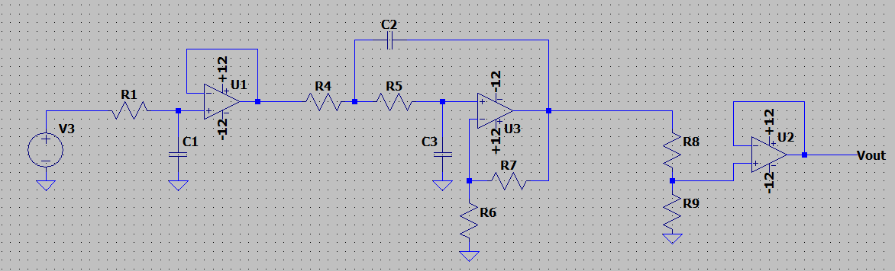
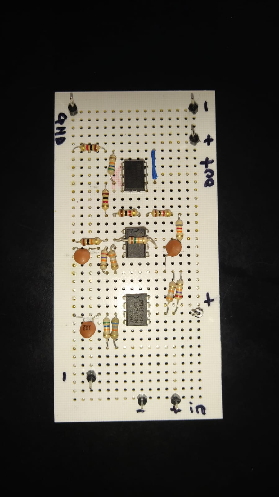
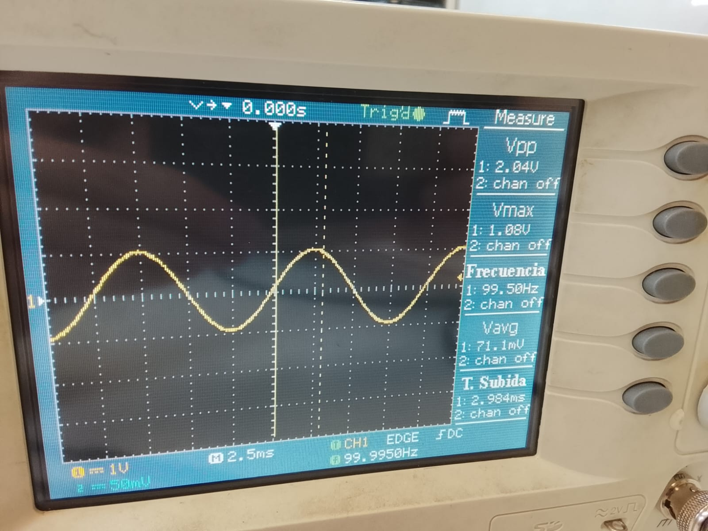
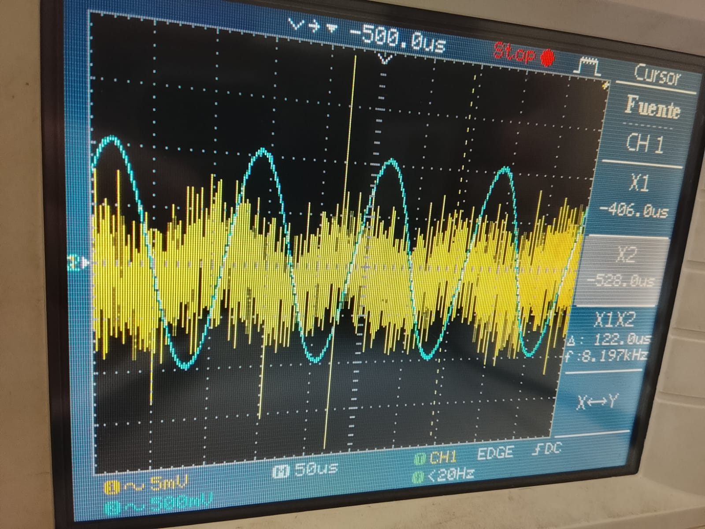

# Filtro Activo de Butterworth, Pasabajo de 1 kHz
> **Asignatura:** Sintesis de Redes Activas - Universidad Nacional de Córdoba
>
> **Integrantes:** 
>  * Quintero,Jonathan Damian
>  * Gandiglio, Lucia Belén
>  * Marchisio, Andres Ignasio
>  * Rodegher, Yaco
 
> **Profesor:**  Ing. Ferreyra, Pablo

---

##  Descripción General 
Filtro pasabajos, con frecuencia de atenuación de 1 kHz, realizado con operacionales LM351.
Para aplicaciones de audio, de ganancia unitaria y carga mínima de 6 ohms

---

###  Hardware 

* **Esquemático del Circuito:** 
  `
* **Consideraciones de Diseño:** Se añadio una ultima etapa para normalizar la ganancia del circuito,
*  con un divisor de tensión y una realimentación unitaria

###  Google Collab:

https://colab.research.google.com/drive/1nJKXVZwFNlXSYXvDSZrQWZm0XDFFcOY5?usp=sharing

###  Parámetros de Alimentación y Consumo 
* **Tensión de operación del sistema:** +/- 6V
* **Método de alimentación:** Fuente partida, circuito apto para recibir la señal con un valor de continua y alimentar solo con tensión positiva
* **Consumo estimado o medido:** 30.6 mW

---

##  Ensayos, Pruebas y Resultados 
Foto del circuito:

Onda resultante 1V  de amplitud y frecuencia de 100 Hz
 
 Onda resultante 1V de amplitud y frecuencia de 8 kHz
 
---

